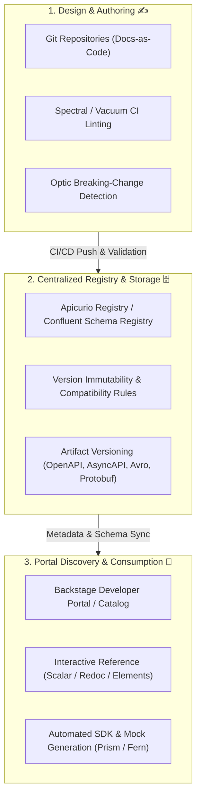

# 🌐 Awesome Centralized API Specifications Repository 🚀

  <b>A curated catalog of Centralized API Specifications Repositories, Schema Registries, and Design-First API Governance Frameworks 📚✨</b> 
  <i>Unifying OpenAPI, AsyncAPI, GraphQL, Protobuf, and Apache Avro specifications into a single source of truth 🎯</i>

---

## 📑 Table of Contents
- [📊 Sector Overview & Market Dynamics](#-sector-overview--market-dynamics)
- [☁️ SaaS & Hosted Platforms](#️-saas--hosted-platforms)
- [💻 Open-Source GitHub Projects](#-open-source-github-projects)
- [🏗️ Architecture & Implementation Patterns](#️-architecture--implementation-patterns)
- [🤝 How to Contribute](#-how-to-contribute)
- [💖 Support](#-support)
- [⭐ Star History](#-star-history)
- [⚖️ Disclaimer & License](#️-disclaimer--license)

---

## 📊 Sector Overview & Market Dynamics

The global API management and governance market is estimated at **$8.6B – $10.3B**, expanding at a rapid **16% – 22% CAGR** as microservices, event-driven architectures, and AI agent integrations make centralized contract repositories essential. The sector is **moderately fragmented**—cloud hyperscalers (AWS, Google Apigee, Microsoft Azure) and established integration vendors anchor runtime gateways, while an agile crop of specialized API-first registries, internal developer portals (IDPs), and schema governance tools capture developer-centric specification workflows without vendor lock-in ⚡.

---

## ☁️ SaaS & Hosted Platforms

The table below highlights leading hosted platforms and SaaS tools for centralized API specification catalogs and schema registries, sorted by company valuation/revenue scale (descending) 🏢:

| 🏷️ Platform | 💰 Company Valuation / Revenue Scale | 💳 Starting Price | 🎁 Free Tier Limits | 📝 Description & Supported Specs |
| :--- | :--- | :--- | :--- | :--- |
| **[Backstage API Catalog (Hosted - Roadie)](https://roadie.io/)** | **Spotify (Creator): ~$110B–$125B Mkt Cap** (€17.2B Rev); Roadie VC-backed | **$24 / developer / month** (Teams tier; minimum seat volume applies) | **No permanent free tier**; 14-day free trial available for PoC evaluations | Managed SaaS distribution of Spotify's CNCF developer portal framework; centralizes multi-protocol API catalogs, entity metadata, and TechDocs. |
| **[Confluent Schema Registry (Cloud)](https://www.confluent.io/confluent-cloud/)** | **~$11B Enterprise Value** ($1.16B TTM Rev; pending IBM acquisition) | **$0 base / month** (Essentials tier; overage charged per schema/hr) | **Free forever plan: Up to 100 schemas**, 10 schema exporters, and 10-minute stream lineage per environment | The industry-standard schema registry for Kafka, Apache Avro, JSON Schema, and Protobuf with compatibility validation and RBAC governance. |
| **[Postman Spec Hub](https://www.postman.com/)** | **~$5.6B Valuation** (~$270M–$313M ARR) | **$9 / user / month** (Solo billed annually; Team collaboration at $19/user/mo) | **Free forever plan: 1 user seat**, unlimited specs & mock servers, 1,000 monitoring requests/mo, 10,000 Postman API calls/mo | Centralized specification hub supporting OpenAPI 2.0/3.0/3.1, AsyncAPI, GraphQL, Protobuf, and Smithy with bi-directional collection syncing. |
| **[SwaggerHub](https://swaggerhub.com/)** | **SmartBear: ~$1.8B Valuation** (~$500M+ Annual Rev) | **$19 / user / month** (Individual billed annually; Team at $29/user/mo) | **Free trial & free evaluation tier: 1 user seat**, capped domains/components, and rate-limited API registry requests | Enterprise source of truth for OpenAPI specs with immutable published releases, reusable domains, mock servers, and style enforcement. |
| **[Stoplight Platform](https://stoplight.io/)** | **SmartBear subsidiary** (Acquired Aug 2023; SmartBear ~$1.8B Val) | **$10 / user / month** (historical Team tier; now bundled into SmartBear plans) | **Free forever plan: 1 project/workspace**, unlimited public docs, Spectral style guide linting, and Prism mocking | Design-first API governance platform providing visual schema editing, Git multi-branch sync, automated changelogs, and dependency graphs. |
| **[ReadMe Enterprise](https://readme.com/)** | **Accel-backed SaaS** (~$15M–$20M ARR est.) | **$250 / project / month** (Pro tier billed annually; Starter at $0) | **Free forever plan: 1 project, 1 published version, 1 admin seat**, custom domain, and 7-day metric retention | API documentation hub with bi-directional GitHub sync, automated interactive API explorer, request metrics, and OpenAPI schema versioning. |
| **[GitBook API Docs](https://www.gitbook.com/)** | **Privately held / Seed-stage** (~$3.7M–$3.9M ARR est.) | **$65 / site / month + $12 / user / month** (Essential billed annually) | **Free forever plan: 1 user seat**, hosted on `.gitbook.io` subdomain (no custom domain), and standard preview deployments | Docs-as-code platform supporting OpenAPI synchronization via URL/CLI, automated 6-hour polling checks, and integrated interactive playground. |
| **[Redocly Workspaces](https://redocly.com/)** | **Bootstrapped / Private** (Leading API docs vendor) | **$729 / month** (Scale tier billed annually; unlimited seats & Git contributors) | **Free open-source tooling** (`@redocly/cli`); SaaS features provide a 14-day free trial on hosted Workspaces | Git-native API registry and developer portal supporting side-by-side multi-version OpenAPI, AsyncAPI, mock servers, and built-in linting. |
| **[Fern Hub](https://buildwithfern.com/)** | **Postman subsidiary** (Acquired Jan 2026; $13M raised prior) | **Custom Enterprise contract** (Self-serve tiers collapsed to Free + Enterprise) | **Free forever plan: Up to 10 team members**, 1 documentation site, and local SDK generation without caps | Docs and multi-language SDK generator from OpenAPI specifications, featuring Docs-as-Code workflows, automated `llms.txt`, and MCP server generation. |
| **[Apicurio Registry (Hosted / OpenShift)](https://www.apicur.io/registry/)** | **Red Hat / IBM subsidiary** (IBM ~$200B+ Mkt Cap; OpenShift flagship) | **Included with Red Hat OpenShift / Integration subscriptions** (Core-pair metric) | **100% Free & open-source upstream**; Red Hat Cloud trial includes 30-day sandbox evaluation | Enterprise-grade multi-protocol schema datastore supporting OpenAPI, AsyncAPI, Avro, JSON Schema, and Protobuf with operator-based deployment. |

---

## 💻 Open-Source GitHub Projects

Explore the top open-source registries, schema storage services, developer catalogs, and spec-first linters. Repositories are sorted by GitHub star count (descending) 🌟:

| 📦 Project | 🌟 Stars | 🛠️ Primary Purpose & Specification Capabilities | 📜 License |
| :--- | :--- | :--- | :--- |
| **[Kong Insomnia](https://github.com/Kong/insomnia)** |  | Collaborative desktop and cloud-synced API development platform for designing, debugging, and testing OpenAPI, GraphQL, REST, and gRPC specs. | Apache-2.0 |
| **[Backstage](https://github.com/backstage/backstage)** |  | Spotify's CNCF Incubation developer portal framework featuring a centralized software catalog for microservice APIs, tech documentation, and plugins. | Apache-2.0 |
| **[Swagger UI](https://github.com/swagger-api/swagger-ui)** |  | Standard interactive web explorer rendering OpenAPI (Swagger 2.0 / OAS 3.x) specifications into browsable, executable documentation. | Apache-2.0 |
| **[Redoc](https://github.com/Redocly/redoc)** |  | OpenAPI/Swagger-generated documentation engine offering customizable responsive three-panel layouts, nested schema trees, and code samples. | MIT |
| **[Scalar](https://github.com/scalar/scalar)** |  | Modern API documentation platform, interactive client, and API specification registry supporting OpenAPI 3.0/3.1 with offline-first design. | MIT |
| **[Swagger Editor](https://github.com/swagger-api/swagger-editor)** |  | Browser-based and standalone editor for authoring and validating OpenAPI specs with real-time linting and instant Swagger UI rendering. | Apache-2.0 |
| **[Stoplight Prism](https://github.com/stoplightio/prism)** |  | Open-source HTTP mock server that turns OpenAPI 2.0/3.x documents into realistic mock APIs with dynamic data generation and contract validation. | Apache-2.0 |
| **[APIs-guru/openapi-directory](https://github.com/APIs-guru/openapi-directory)** |  | Wikipedia of Web APIs: The largest community-maintained open directory and catalog of public REST API specifications formatted in OpenAPI. | CC0-1.0 |
| **[Stoplight Spectral](https://github.com/stoplightio/spectral)** |  | Flexible JSON/YAML and OpenAPI linter for enforcing API style guides, governance rules, and schema standards in CI/CD pipelines. | Apache-2.0 |
| **[Confluent Schema Registry](https://github.com/confluentinc/schema-registry)** |  | Distributed schema storage backend and REST interface for Apache Kafka, governing Avro, JSON Schema, and Protobuf schema compatibility. | Confluent Community |
| **[Stoplight Elements](https://github.com/stoplightio/elements)** |  | Beautiful, responsive, three-column API documentation web components powered by OpenAPI and Markdown. | Apache-2.0 |
| **[Optic](https://github.com/opticdev/optic)** |  | Git-native API contract testing and OpenAPI linting tool that detects breaking changes, diffs schemas, and automates PR reviews. | MIT |
| **[Vacuum](https://github.com/daveshanley/vacuum)** |  | High-speed OpenAPI 3, AsyncAPI, and JSON Schema linter written in Go; designed for ultra-fast performance in enterprise CI/CD gates. | MIT |
| **[Apicurio Registry](https://github.com/Apicurio/apicurio-registry)** |  | Centralized datastore for API designs and event schemas (OpenAPI, AsyncAPI, Avro, Protobuf) with REST API, UI, and storage plugins. | Apache-2.0 |
| **[pb33f libopenapi](https://github.com/pb33f/libopenapi)** |  | High-performance Go library for parsing, validating, resolving, and analyzing OpenAPI v2, v3, and v3.1 documents. | MIT |
| **[Apinf Platform](https://github.com/apinf/platform)** |  | Open-source API management platform featuring API catalogs, developer portals, proxy integration, and spec discovery. | MIT |

---

## 🏗️ Architecture & Implementation Patterns

Building a production-ready, vendor-neutral API specification repository typically combines three core layers:

1. **Governance at the Edge**: Lint schemas via **Spectral** or **Vacuum** and detect breaking changes with **Optic** directly inside GitHub Actions before merges.
2. **Centralized Schema Ingestion**: Store validated OpenAPI, AsyncAPI, and Avro artifacts in **Apicurio Registry** or **Confluent Schema Registry** with strict compatibility rules.
3. **Federated Developer Discovery**: Ingest metadata into **Backstage Software Catalog** to give engineering teams cross-organization visibility into endpoints, owners, and documentation.

---

## 🤝 How to Contribute

We welcome additions of new tools, registries, and linters! ✨

1. **Fork the repository** to your own GitHub account 🍴.
2. **Add or update entries** in `README.md`:
   - For SaaS products, include company valuation/revenue scale, starting price, and specific free tier limits.
   - For Open-Source repositories, include repo link, social star badge `https://img.shields.io/github/stars/{owner}/{repo}?style=social&color=white` linking to the stargazers page, description, and license.
3. **Maintain alphabetical or sorted order** within each respective section.
4. **Submit a Pull Request** with a descriptive title and summary of changes 🚀.

---

## 💖 Support

Thank you so much for exploring and supporting this curated resource! 🙌

If you found this repository helpful:
- ⭐ **Star this repository** to show your support and make it easier for others to find!
- 🍴 **Fork it** and contribute your own tooling recommendations.
- 📢 **Share it** with fellow API architects, engineers, and platform teams!
- ☕ **Sponsor / Buy me a coffee**: If you'd like to back ongoing maintenance, check out the [GitHub Sponsor Dashboard](https://github.com/sponsors/ishandutta2007) ❤️.

---

## ⭐ Star History

---

## ⚖️ Disclaimer & License

- This repository is a **community-curated** index intended for educational and architectural evaluation.
- All product names, trademarks, and registered trademarks belong to their respective owners.
- Repository content is available under the [MIT License](LICENSE).
